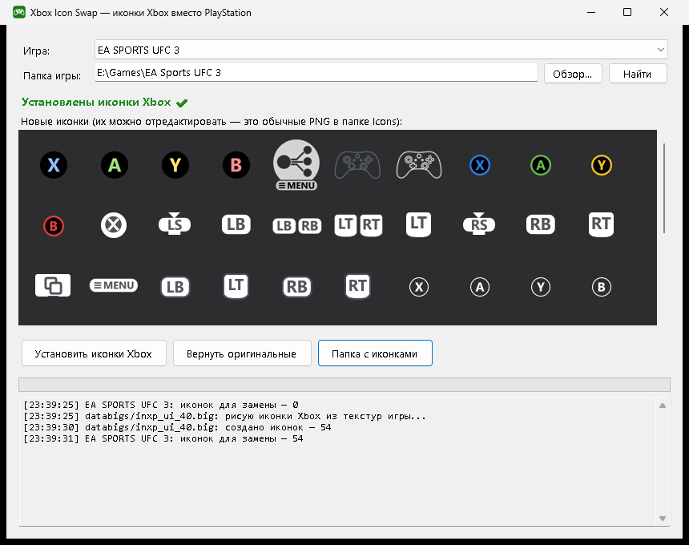
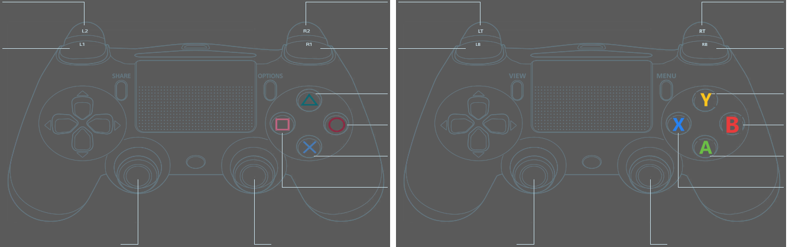
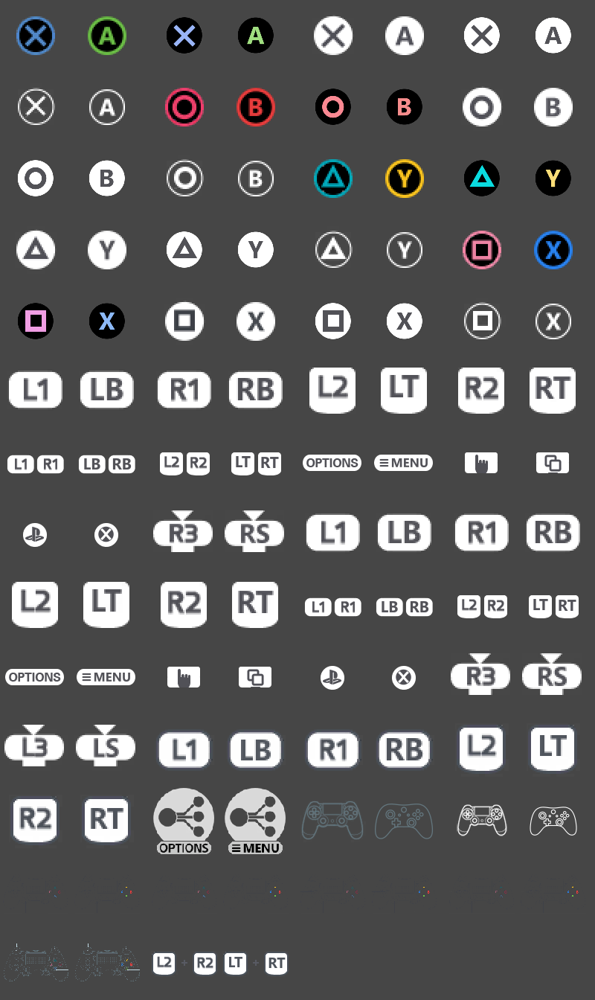

# Xbox Icon Swap

Иконки кнопок **Xbox** вместо PlayStation в PC-портах игр с PS4.

Играете в порт с PS4 на геймпаде Xbox, а игра показывает ✕ ○ △ □ и L1/R2? Программа заменит их на A B X Y, LB/RT, Menu и View одной кнопкой. Вернуть всё обратно тоже можно одной кнопкой.

> **Поддерживается и проверено:** только **EA SPORTS UFC 3**, нативный PC-порт
> [UFC-3-PS4-PORT-LINUX-WINDOWS](https://github.com/GNSB/UFC-3-PS4-PORT-LINUX-WINDOWS)
> (CUSA06534, обновление 1.14). На других портах, эмуляторах и версиях программа не проверялась.



## Что меняется

| Было (PS4) | Стало (Xbox) |
|---|---|
| ✕ ○ △ □ | A B X Y (во всех стилях: цветные, белые, крупные, контурные) |
| L1 R1 / L2 R2 | LB RB / LT RT (и парные «L1 R1», «L2 + R2») |
| L3 / R3 | LS / RS |
| OPTIONS | ≡ MENU |
| тачпад | кнопка View |
| кнопка PS | кнопка Xbox |
| силуэт DualShock 4 | силуэт геймпада Xbox |
| кнопки главного меню | оригинальные Xbox-кнопки EA: они есть в файлах игры, программа включает их вместо PS-версий |

Схема в меню «Управление» — было / стало:



<details>
<summary>Все заменяемые иконки (слева оригинал, справа замена)</summary>



</details>

## Установка и использование

1. Скачайте `XboxIconSwap-v1.0.0.zip` со страницы [Releases](../../releases) и распакуйте в любую папку.
2. Закройте игру и её лаунчер (`UFC3.exe`).
3. Запустите `XboxIconSwap.exe`.
   - Папка игры находится автоматически по настройкам лаунчера порта. Если не нашлась, нажмите **«Обзор...»** и укажите папку, где лежат `eboot.bin` и `databigs`.
   - При первом запуске программа за пару секунд нарисует иконки Xbox из текстур вашей копии игры.
4. Нажмите **«Установить иконки Xbox»** и запускайте игру как обычно.

Вернуть оригинал: кнопка **«Вернуть оригинальные»**. Файлы игры восстанавливаются байт в байт.

**Требования:** Windows 10/11 x64 и [.NET 8 Desktop Runtime](https://dotnet.microsoft.com/download/dotnet/8.0). Если рантайма нет, Windows сама предложит его скачать.

### Без окна (для ярлыков и скриптов)

```
XboxIconSwap.exe --install "E:\Games\EA Sports UFC 3"
XboxIconSwap.exe --restore "E:\Games\EA Sports UFC 3"
```

Код возврата `0` означает успех. Журнал пишется в `XboxIconSwap.log` рядом с программой.

### Свои иконки

Иконки — обычные PNG в `Icons\UFC3\inxp_ui_40\…`. Их можно перерисовать в любом редакторе с прозрачностью и снова нажать «Установить». Размер картинки лучше сохранить. Чтобы программа нарисовала иконки заново, удалите папку `inxp_ui_40`.

## Как это работает

Игра хранит интерфейс в архивах EA `databigs\*.big` (формат «EB» v3).

- **Текстуры кнопок** (`skins/buttons/ps3/…`, схемы контроллера) — GNF-текстуры PS4 в формате BC7 с PS4-тайлингом. Программа декодирует оригиналы, рисует Xbox-версии с сохранением формы и стиля плашек, кодирует обратно в BC7 с тем же тайлингом, размером и заголовком.
- **Главное меню** (Scaleform, `samplefedata.swf` и `tin.swf`) уже содержит обе версии кнопок, `Btn_*_ps_mc` и `Btn_*_xb_mc`. Программа меняет местами их ID в таблицах SymbolClass/ExportAssets. Меняется около 230 байт, графика не трогается.

**Почему это безопасно:**

- новые данные **дописываются в конец** архива, существующие байты не перезаписываются;
- в таблице архива меняются только ссылки на изменённые файлы;
- рядом с архивом создаётся `*.xboxicons.bak` (десятки КБ) с исходной таблицей и размером файла, по нему откат возвращает архив байт в байт;
- повторная установка сначала откатывает прошлую, поэтому файл не растёт;
- если игра запущена, программа ничего не меняет и просит её закрыть.

> Не удаляйте `*.xboxicons.bak`, пока установлены иконки Xbox. Если будете обновлять или заменять файлы игры, сначала нажмите «Вернуть оригинальные».

### Файлы игры не распространяются

В репозитории и релизах **только код**. Иконки рисуются на вашем компьютере из вашей копии игры. Изображения в `docs/` — скриншоты для иллюстрации.

## Сборка из исходников

Нужен .NET 8 SDK или новее.

```powershell
.\build.ps1          # программа -> .\XboxIconSwap, архив релиза -> .\release
```

| Проект | Назначение |
|---|---|
| `src/IconSwap.Core` | архивы EB, chunkzip, GNF и тайлинг PS4, кодер/декодер BC7, SWF, установка/откат, отрисовка иконок |
| `src/XboxIconSwap` | программа (WinForms) и профили игр `Icons/<игра>/profile.json` |
| `src/IconBuilder` | утилита разработчика: `selftest`, `extract`, `build`, `patchtest`, `swftest` |

### Другие игры

Поддержка игры описывается профилем `Icons/<Игра>/profile.json`: архивы, префикс путей, SWF-пары и способ найти папку игры. Порты других игр EA Sports того же поколения могут использовать тот же формат. Профили и проверки на других играх приветствуются в Issues и Pull Requests.

## English

**Xbox Icon Swap** replaces PlayStation button prompts with Xbox ones in PS4→PC ports.
Supported and tested **only** with the native PC port of **EA SPORTS UFC 3** (CUSA06534, update 1.14).
Download the release zip, close the game, run `XboxIconSwap.exe` and press «Установить иконки Xbox» (Install); «Вернуть оригинальные» restores the original files byte for byte.
The tool appends re-encoded BC7 textures to the game's EB archives, rewrites only the entry table (a small `.xboxicons.bak` keeps the original table), and switches the Scaleform menus to the Xbox button symbols EA already shipped. No game files are distributed: icons are rendered from your own copy of the game.

## Лицензия

[MIT](LICENSE): свободно используйте, изменяйте и распространяйте.

Проект не связан с Electronic Arts, Sony Interactive Entertainment, Microsoft или UFC. Названия и логотипы Xbox, PlayStation, EA SPORTS и UFC принадлежат их владельцам.
